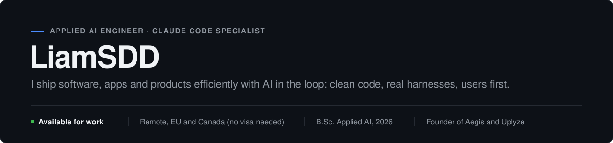
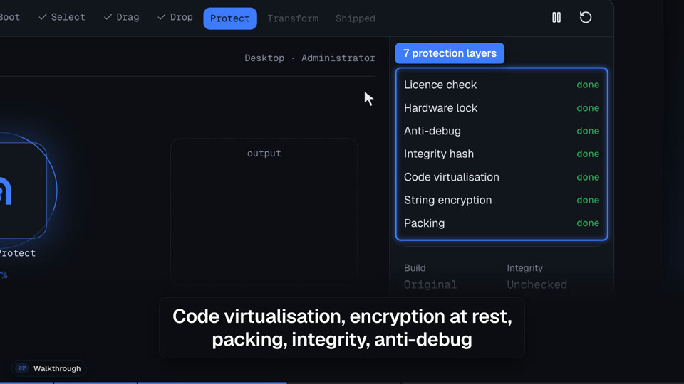
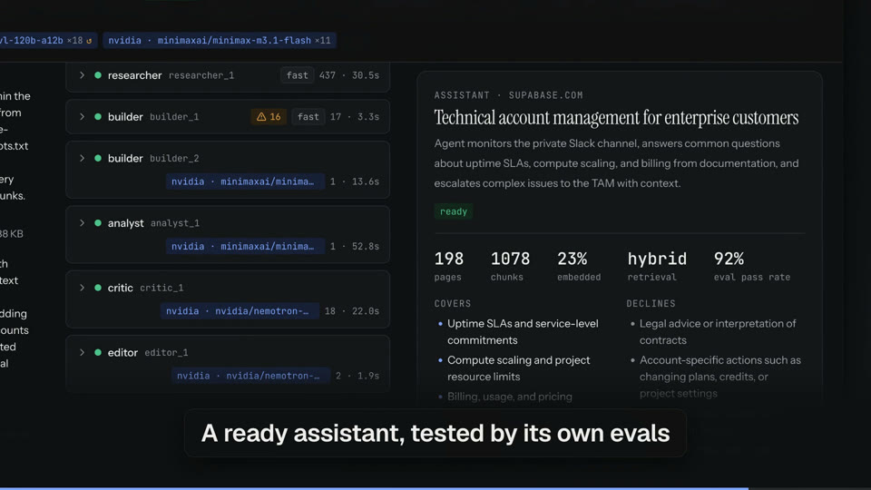
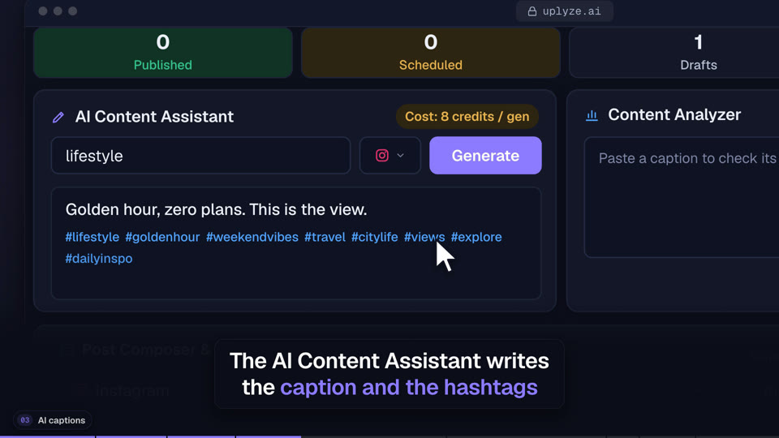
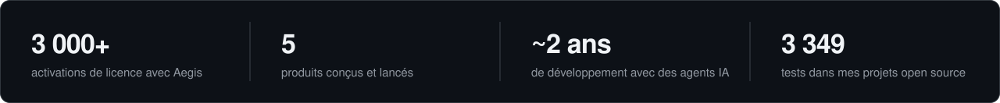
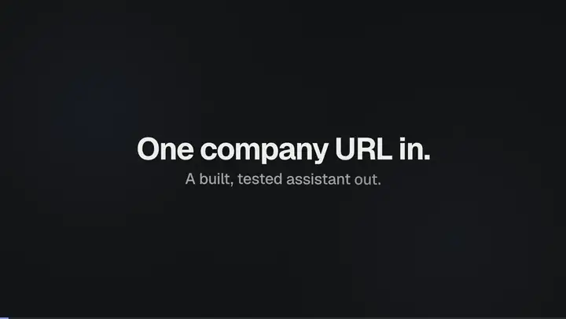
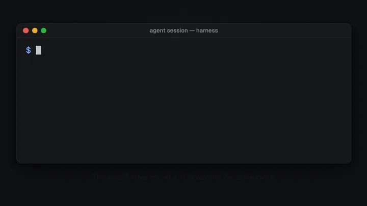
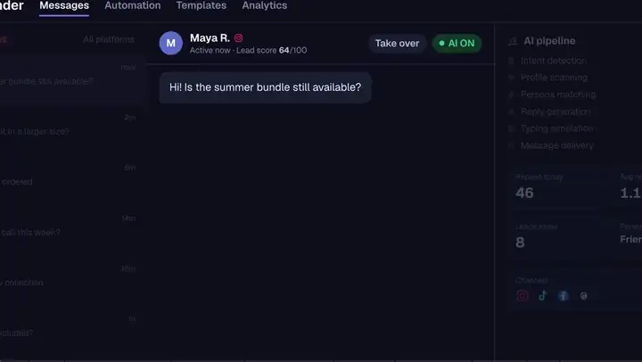
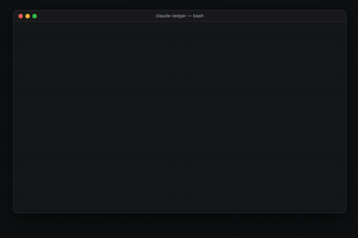
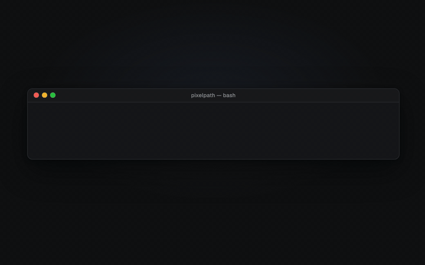

<picture>
  <source media="(prefers-color-scheme: dark)" srcset="assets/banner-dark.svg">
  <source media="(prefers-color-scheme: light)" srcset="assets/banner-light.svg">
  
</picture>

<a href="https://github.com/LiamSDD">English</a> · <b>Français</b>

<table>
<tr>
<td width="33%" align="center"> <b>Aegis</b> · 31 s protéger le build d'un jeu</td>
<td width="33%" align="center"> <b>Delegate</b> · 62 s une URL en entrée, un assistant prêt à l'emploi en sortie</td>
<td width="33%" align="center"> <b>Uplyze</b> · 59 s messages automatisés, campagnes et contenus</td>
</tr>
</table>

<picture>
  <source media="(prefers-color-scheme: dark)" srcset="assets/stats-dark-fr.svg">
  <source media="(prefers-color-scheme: light)" srcset="assets/stats-light-fr.svg">
  
</picture>

> **Vous recrutez ? Commencez ici** 
> ▶ **Essayer :** [la démo en ligne de Delegate](https://delegate-beryl.vercel.app), sans inscription 
> ▶ **Lire :** [l'étude de cas Delegate](https://github.com/LiamSDD/delegate/blob/main/docs/CASE_STUDY.md) (en anglais) 
> ▶ **Je cherche :** un poste d'ingénieur IA (Applied AI Engineer), en télétravail, depuis l'UE ou le Canada 
> ▶ **Contact :** [liam@ozcagency.com](mailto:liam@ozcagency.com) (adresse de ma propre agence) · [réserver un appel de 20 min](https://cal.com/liamsdd/intro-call)

## Ce que j'apporte

- **La rapidité de l'IA, sans sacrifier la qualité.** Mes agents de code travaillent dans un cadre que j'ai conçu : tests d'abord, petites PR faciles à relire, et rien n'est terminé tant que ce n'est pas vérifié.
- **L'utilisateur au centre.** Je pars de ce que les gens voient et attendent, puis je conçois des parcours simples et rapides.
- **Des coûts d'IA maîtrisés.** Routage entre modèles, mise en cache et budgets de tokens pour que les fonctionnalités LLM restent rentables.
- **La sécurité dès la conception.** Gestion des licences, protection anti-falsification et détection de secrets, éprouvées avec Aegis.
- **Une vision produit de bout en bout.** J'ai conçu, lancé et commercialisé mes propres produits.

## Projets phares

<table>
<tr>
<td width="50%" valign="top">

### <picture><source media="(prefers-color-scheme: dark)" srcset="assets/aegis-logo-white-text.svg"><source media="(prefers-color-scheme: light)" srcset="assets/aegis-logo-black-text.svg"></picture>
`fondateur` `C++` `C` `sécurité`

Protection logicielle et gestion de licences pour jeux vidéo et applications desktop : virtualisation du code, chiffrement au repos, clés de licence et anti-falsification, côté client comme côté serveur.

**Plus de 3 000 licences vendues** · fondateur et lead dev 
[shieldaegis.cloud](https://shieldaegis.cloud) · [vidéo](assets/demos/aegis-demo-1080p60.mp4) · code source privé

</td>
<td width="50%" valign="top">

### &nbsp;[Delegate](https://github.com/LiamSDD/delegate)
`open source` `TypeScript` `multi-agents`

À partir d'un objectif, du site d'une entreprise ou d'un dépôt GitHub, Delegate livre un travail abouti et vérifié : les agents travaillent en parallèle, chaque affirmation est sourcée, et toute action sensible attend votre feu vert.

**2 700 tests** · fonctionne à coût zéro sur des modèles gratuits 
[démo en ligne](https://delegate-beryl.vercel.app) · [vidéo](assets/demos/delegate-demo-1080p60.mp4) · [étude de cas](https://github.com/LiamSDD/delegate/blob/main/docs/CASE_STUDY.md)

</td>
</tr>
<tr>
<td width="50%" valign="top">

### &nbsp;[Claude Code Harness Pro Max](https://github.com/LiamSDD/claude-code-harness-pro-max)
`plugin Claude Code` `open source` `Python`

Des garde-fous pour les agents de code IA : il bloque les commandes destructrices et les fuites de secrets, plafonne les coûts et oblige l'agent à prouver ce qu'il avance.

**238 tests** · 0 dépendance · compatible avec 6 agents de code 
[code source](https://github.com/LiamSDD/claude-code-harness-pro-max) · [vidéo](assets/demos/claude-code-harness-pro-max-demo.mp4)

</td>
<td width="50%" valign="top">

### &nbsp;[Uplyze](https://uplyze.ai)
`produit` `copilote IA` `automatisation`

La plateforme de croissance tout-en-un, propulsée par l'IA, pour les créateurs et les entreprises : réponses et messages privés automatisés, contenus, planification et statistiques au même endroit.

**Produit en production**, avec offres payantes 
[uplyze.ai](https://uplyze.ai) · [vidéo](assets/demos/uplyze-demo-1080p60.mp4)

</td>
</tr>
<tr>
<td width="50%" valign="top">

### &nbsp;[claude-ledger](https://github.com/LiamSDD/claude-ledger)
`CLI pour Claude Code` `open source` `Python`

Montre où partent vos tokens et vos dollars Claude Code, puis propose des économies chiffrées.

**136 tests** · 0 dépendance · hors ligne 
[code source](https://github.com/LiamSDD/claude-ledger) · [vidéo](assets/demos/claude-ledger-demo.mp4)

</td>
<td width="50%" valign="top">

### &nbsp;[pixelpath](https://github.com/LiamSDD/pixelpath)
`open source` `Python` `graphisme`

Convertit des SVG en PNG nets et transparents avec la seule bibliothèque standard de Python.

**275 tests** · 0 dépendance · analyse XML sécurisée 
[code source](https://github.com/LiamSDD/pixelpath) · [vidéo](assets/demos/pixelpath-demo.mp4)

</td>
</tr>
</table>

**Également réalisés :** ChatFlow (réponses par IA sur Instagram, Messenger et WhatsApp) et Vocalis (génération de chansons par IA à partir d'une voix consentie).

## Stack technique

**Au quotidien :** Python · TypeScript · C++ · C · Postgres · Next.js · React · Electron 
**IA :** Claude Code · Anthropic API · Codex · Cursor · MCP · multi-agents · evals 
**Posez-moi des questions sur :** les runtimes d'agents sans framework · la virtualisation de code · la réduction des coûts LLM

---

**Disponible** · télétravail · UE ou Canada · [liam@ozcagency.com](mailto:liam@ozcagency.com) · [réserver un appel](https://cal.com/liamsdd/intro-call) · [portfolio](https://liamsdd.github.io/?lang=fr)
