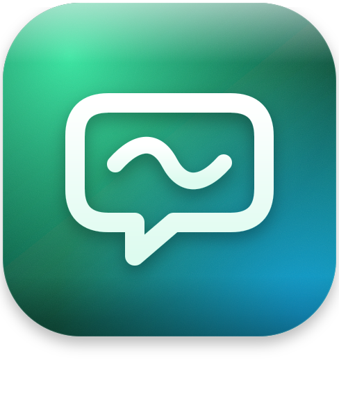
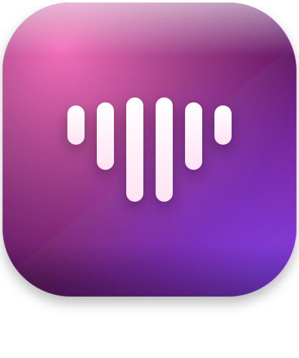

<picture>
  <source media="(prefers-color-scheme: dark)" srcset="assets/banner-dark.svg">
  <source media="(prefers-color-scheme: light)" srcset="assets/banner-light.svg">
  
</picture>

**Applied AI Engineer and Claude Code specialist.** I ship software, applications and products efficiently with AI built into the way I work. I run coding agents inside proper harnesses, so the speed comes with clean, tested, reviewable code, and every decision starts from the user's experience.

<picture>
  <source media="(prefers-color-scheme: dark)" srcset="assets/stats-dark-v4.svg">
  <source media="(prefers-color-scheme: light)" srcset="assets/stats-light-v4.svg">
  
</picture>

## What I bring on day one

- **AI-assisted delivery without the mess.** I build with coding agents every day, inside a harness I wrote myself: skills, permissions, hooks and subagents. You get the speed of AI with code a reviewer can trust. See [Claude Code Harness Pro Max](https://github.com/LiamSDD/claude-code-harness-pro-max) and [Delegate](https://github.com/LiamSDD/delegate).
- **Code sanity first.** Test-first changes, small pull requests that are easy to review, clear docs and versioned releases. Nothing is called done until it has been verified.
- **Users before features.** I start from what the user sees and needs, then engineer backwards to fast, clear, simple flows. I don't ship a feature I wouldn't want to use myself.
- **AI that stays affordable.** Model routing, prompt caching, token budgets and spend reporting keep AI features cheap to run at scale. See [claude-ledger](https://github.com/LiamSDD/claude-ledger).
- **Security built in.** Licensing, anti-tamper, anti-debug and secret scanning by default, proven in [Aegis](https://shieldaegis.cloud) with 3,000+ licence keys sold.
- **Ownership from idea to release.** I have designed, built, shipped and sold my own products, so I can own a feature end to end and keep sight of what users actually pay for. See [Uplyze](https://uplyze.ai) and [Aegis](https://shieldaegis.cloud).

## Featured work

<table>
<tr>
<td width="50%" valign="top">

### <picture><source media="(prefers-color-scheme: dark)" srcset="assets/aegis-logo-white-text.svg"><source media="(prefers-color-scheme: light)" srcset="assets/aegis-logo-black-text.svg"></picture>
`product` `founder` `C++` `C` `React` `Electron` `security`

Software protection and licensing for games and desktop apps. A custom packer with code virtualisation, encryption at rest and per-build stubs, combined with licence keys, hardware lock, anti-debug and integrity checks, enforced on both the client and the server.

**My role:** founder and lead engineer. I designed and built the native protection engine in C and C++, the licensing server and the React and Electron app developers use to protect a build, over about 8 months from late 2025, with help from a few engineers in my network.

**3,000+ licence keys sold** to mid-size studios shipping on Steam and to independent developers. 
[shieldaegis.cloud](https://shieldaegis.cloud) · [31 s video](assets/demos/aegis-demo-1080p60.mp4) · source is private

</td>
<td width="50%" valign="top">

### &nbsp;[Delegate](https://github.com/LiamSDD/delegate)
`open source` `TypeScript` `agent platform` `multi-agent`

An agent platform that turns a goal, a company URL or a GitHub repository into finished, verified work: it plans, runs specialist agents in parallel, checks every claim against its source and asks before any side effect. A hand-written agent runtime with a quarantined reader against prompt injection, a policy engine on every tool call, an append-only event log for replay and forks, and an MCP server for Claude Code and Codex.

**[Live demo →](https://delegate-beryl.vercel.app)** · **1,885 tests** · 0% attack success on a 110-attack red-team suite · evals on every mission · fork any run from any step · $0 on free models

</td>
</tr>
<tr>
<td width="50%" valign="top">

### &nbsp;[Claude Code Harness Pro Max](https://github.com/LiamSDD/claude-code-harness-pro-max)
`open source` `Python` `Claude Code` `harness`

The harness I use to build software with AI: it blocks destructive commands and leaked secrets, enforces limits on replies, prompts and budgets, routes subagents to the right model, and makes the agent prove its work before it says "done".

**21 skills** · **7 agents** · **238 tests** · **0 dependencies** 
Works with Claude Code, Codex, Cursor, Gemini CLI, Antigravity and Kimi. It is the harness every project on this profile was built with.

</td>
<td width="50%" valign="top">

### &nbsp;[Uplyze](https://uplyze.ai)
`product` `AI copilot` `growth automation`

All-in-one growth AI for creators, agencies and businesses. An AI copilot analyses content performance, plans and schedules posts, and automates marketing and sales workflows, replacing a stack of separate tools.

[uplyze.ai](https://uplyze.ai) · live product with Starter, Pro and Studio plans

</td>
</tr>
<tr>
<td width="50%" valign="top">

### &nbsp;[claude-ledger](https://github.com/LiamSDD/claude-ledger)
`open source` `Python` `LLM cost`

Shows where Claude Code tokens and dollars go, by model, project, day, session and subagent, then suggests savings with their dollar impact. Read-only and offline.

**136 tests** · **0 dependencies** · Markdown, JSON and CSV output

</td>
<td width="50%" valign="top">

### &nbsp;ChatFlow
`product` `LLM assistant` `automation`

An AI assistant that answers Instagram Direct, Facebook Messenger and WhatsApp conversations in a natural tone, so no lead is lost to an unanswered message.

Source is private.

</td>
</tr>
<tr>
<td colspan="2" valign="top">

### &nbsp;Vocalis
`product` `generative audio`

Turns a consented voice, an instrumental and a prompt or lyrics into a complete song in that voice, at the chosen tempo. Source is private.

</td>
</tr>
</table>

## Stack

**Languages** 

**AI engineering** 

**Focus** 
`applied AI` `agent harnesses` `multi-agent workflows` `code quality` `user experience` `LLM cost control` `software security`

## Open to work

I am looking for an engineering role where AI is part of how the work gets done. That means building applications, software and products with harness-driven development and clean code, and putting the user's experience first. Remote, with no visa needed in the EU or Canada.
