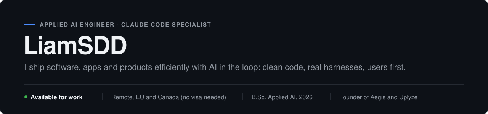
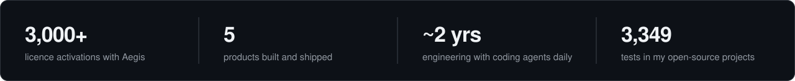
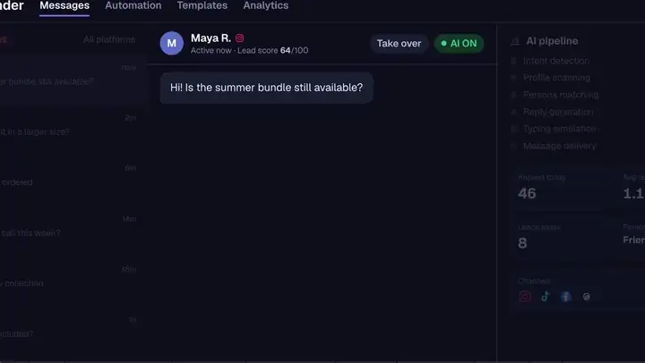

<picture>
  <source media="(prefers-color-scheme: dark)" srcset="assets/banner-dark.svg">
  <source media="(prefers-color-scheme: light)" srcset="assets/banner-light.svg">
  
</picture>

<b>English</b> · <a href="README.fr.md">Français</a>

<table>
<tr>
<td width="33%" align="center"> <b>Aegis</b> · 31 s protecting a game build</td>
<td width="33%" align="center"> <b>Delegate</b> · 62 s one URL in, a built assistant out</td>
<td width="33%" align="center"> <b>Uplyze</b> · 59 s AI DMs, campaigns and content</td>
</tr>
</table>

<picture>
  <source media="(prefers-color-scheme: dark)" srcset="assets/stats-dark-v5.svg">
  <source media="(prefers-color-scheme: light)" srcset="assets/stats-light-v5.svg">
  
</picture>

> **Hiring? Start here** 
> ▶ **Try:** [Delegate live demo](https://delegate-beryl.vercel.app), no sign-up 
> ▶ **Read:** [the Delegate case study](https://github.com/LiamSDD/delegate/blob/main/docs/CASE_STUDY.md) 
> ▶ **Looking for:** Applied AI Engineer roles · remote · EU or Canada 
> ▶ **Contact:** [liam@ozcagency.com](mailto:liam@ozcagency.com) (my own agency's domain) · [book a 20-min call](https://cal.com/liamsdd/intro-call)

## What I bring

- **AI speed, reviewable code.** Coding agents in a harness I built: tests first, small PRs, verified before "done".
- **Users first.** I design from what people see and need, then build back to simple, fast flows.
- **AI that stays cheap.** Model routing, caching and token budgets keep LLM features affordable.
- **Security by default.** Licensing, anti-tamper and secret scanning, proven in Aegis.
- **End-to-end ownership.** I've built, shipped and sold my own products.

## Featured work

<table>
<tr>
<td width="50%" valign="top">

### <picture><source media="(prefers-color-scheme: dark)" srcset="assets/aegis-logo-white-text.svg"><source media="(prefers-color-scheme: light)" srcset="assets/aegis-logo-black-text.svg"></picture>
`founder` `C++` `C` `security`

Software protection and licensing for games and desktop apps: code virtualisation, encryption at rest, licence keys and anti-tamper, enforced client and server side.

**3,000+ licence keys sold** · founder and lead engineer 
[shieldaegis.cloud](https://shieldaegis.cloud) · [video](assets/demos/aegis-demo-1080p60.mp4) · private source

</td>
<td width="50%" valign="top">

### &nbsp;[Delegate](https://github.com/LiamSDD/delegate)
`open source` `TypeScript` `multi-agent`

Turns a goal, a company URL or a repo into finished, verified work. Agents run in parallel, every claim is checked against its source, and risky actions wait for approval.

**2,700 tests** · runs for $0 on free models 
[live demo](https://delegate-beryl.vercel.app) · [video](assets/demos/delegate-demo-1080p60.mp4) · [case study](https://github.com/LiamSDD/delegate/blob/main/docs/CASE_STUDY.md)

</td>
</tr>
<tr>
<td width="50%" valign="top">

### &nbsp;[Claude Code Harness Pro Max](https://github.com/LiamSDD/claude-code-harness-pro-max)
`Claude Code plugin` `open source` `Python`

Guardrails for AI coding agents: blocks destructive commands and leaked secrets, caps cost, and makes the agent prove its work.

**238 tests** · 0 dependencies · works with 6 coding agents 
[source](https://github.com/LiamSDD/claude-code-harness-pro-max) · [video](assets/demos/claude-code-harness-pro-max-demo.mp4)

</td>
<td width="50%" valign="top">

### &nbsp;[Uplyze](https://uplyze.ai)
`product` `AI copilot` `automation`

All-in-one growth AI for creators and businesses: AI replies and DMs, content, scheduling and insights in one place.

**Live product** with paid plans 
[uplyze.ai](https://uplyze.ai) · [video](assets/demos/uplyze-demo-1080p60.mp4)

</td>
</tr>
<tr>
<td width="50%" valign="top">

### &nbsp;[claude-ledger](https://github.com/LiamSDD/claude-ledger)
`CLI for Claude Code` `open source` `Python`

Shows where your Claude Code tokens and dollars go, then suggests savings with their impact.

**136 tests** · 0 dependencies · offline 
[source](https://github.com/LiamSDD/claude-ledger) · [video](assets/demos/claude-ledger-demo.mp4)

</td>
<td width="50%" valign="top">

### &nbsp;[pixelpath](https://github.com/LiamSDD/pixelpath)
`open source` `Python` `graphics`

Renders SVG to crisp, transparent PNGs with only the Python standard library.

**275 tests** · 0 dependencies · safe XML 
[source](https://github.com/LiamSDD/pixelpath) · [video](assets/demos/pixelpath-demo.mp4)

</td>
</tr>
</table>

**Also built:** ChatFlow (AI replies for Instagram, Messenger and WhatsApp) and Vocalis (AI song generation from a consented voice).

## Stack

**Daily:** Python · TypeScript · C++ · C · Postgres · Next.js · React · Electron 
**AI:** Claude Code · Anthropic API · Codex · Cursor · MCP · multi-agent · evals 
**Ask me about:** agent runtimes without frameworks · code virtualisation · cutting LLM cost

---

**Open to work** · remote · EU or Canada · [liam@ozcagency.com](mailto:liam@ozcagency.com) · [book a call](https://cal.com/liamsdd/intro-call) · [portfolio](https://liamsdd.github.io)
