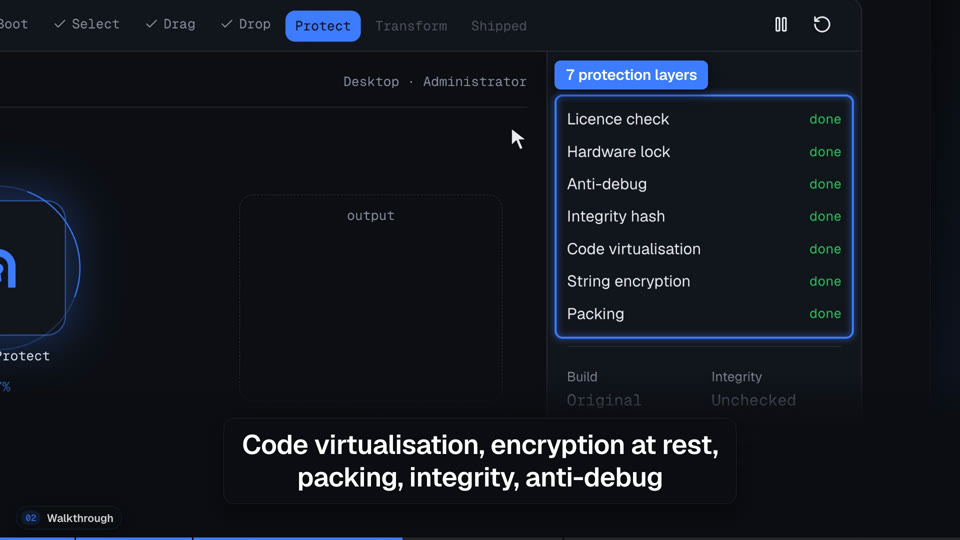
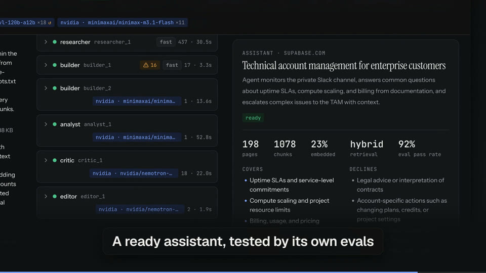
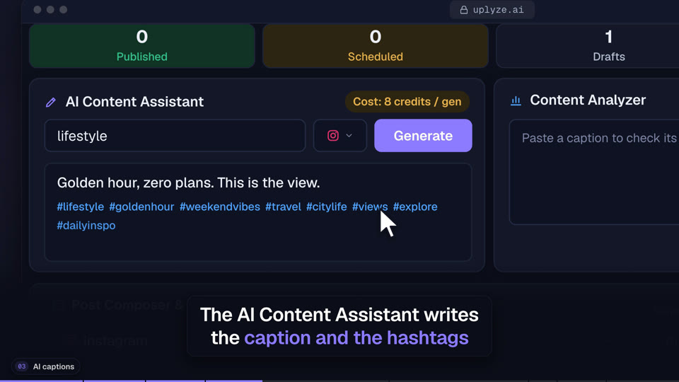
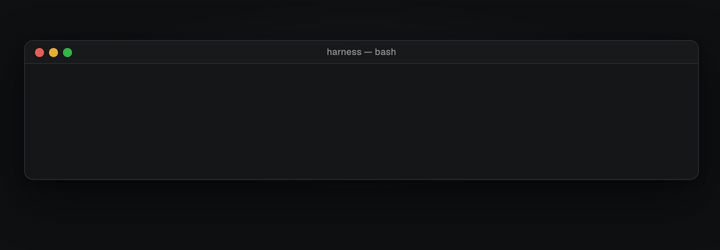
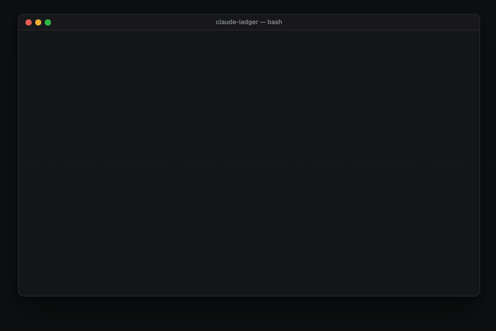
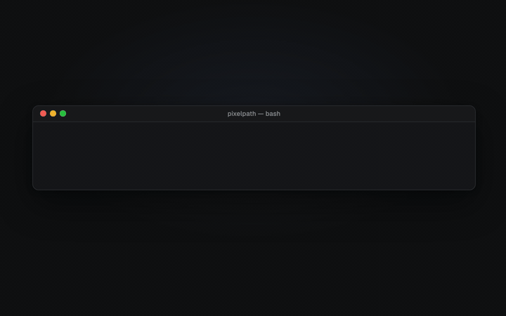

<picture>
  <source media="(prefers-color-scheme: dark)" srcset="assets/banner-dark.svg">
  <source media="(prefers-color-scheme: light)" srcset="assets/banner-light.svg">
  
</picture>

**Applied AI Engineer and Claude Code specialist.** I ship software, applications and products efficiently with AI built into the way I work. I run coding agents inside proper harnesses, so the speed comes with clean, tested, reviewable code, and every decision starts from the user's experience.

> **Hiring? The 90-second path** 
> ▶ **Try it:** [Delegate live demo](https://delegate-beryl.vercel.app), a multi-agent platform running on free models, no sign-up 
> ▶ **Watch it:** the three one-minute videos below 
> ▶ **Read how I think:** [the Delegate case study](https://github.com/LiamSDD/delegate/blob/main/docs/CASE_STUDY.md), covering design choices, trade-offs and what I would do differently 
> ▶ **Looking for:** Applied AI Engineer roles, remote, EU or Canada, no visa needed 
> ▶ **Contact:** [liam@ozcagency.com](mailto:liam@ozcagency.com), on the domain of the agency I own and run · [book a 20-min intro call](https://cal.com/freshsum-freshsum-irifcg/intro-call)

<table>
<tr>
<td width="33%" align="center"> <b>Aegis</b> · 31 s protecting a game build</td>
<td width="33%" align="center"> <b>Delegate</b> · 60 s real live runs, unedited output</td>
<td width="33%" align="center"> <b>Uplyze</b> · 54 s AI captions to scheduled posts</td>
</tr>
</table>

<picture>
  <source media="(prefers-color-scheme: dark)" srcset="assets/stats-dark-v5.svg">
  <source media="(prefers-color-scheme: light)" srcset="assets/stats-light-v5.svg">
  
</picture>

## What I bring on day one

- **AI-assisted delivery without the mess.** I build with coding agents every day, inside a harness I wrote myself: skills, permissions, hooks and subagents. You get the speed of AI with code a reviewer can trust. See [Claude Code Harness Pro Max](https://github.com/LiamSDD/claude-code-harness-pro-max) and [Delegate](https://github.com/LiamSDD/delegate).
- **Code sanity first.** Test-first changes, small pull requests that are easy to review, clear docs and versioned releases. Nothing is called done until it has been verified.
- **Users before features.** I start from what the user sees and needs, then engineer backwards to fast, clear, simple flows. I don't ship a feature I wouldn't want to use myself.
- **AI that stays affordable.** Model routing, prompt caching, token budgets and spend reporting keep AI features cheap to run at scale. See [claude-ledger](https://github.com/LiamSDD/claude-ledger).
- **Security built in.** Licensing, anti-tamper, anti-debug and secret scanning by default, proven in [Aegis](https://shieldaegis.cloud) with 3,000+ licence keys sold.
- **Ownership from idea to release.** I have designed, built, shipped and sold my own products, so I can own a feature end to end and keep sight of what users actually pay for. See [Uplyze](https://uplyze.ai) and [Aegis](https://shieldaegis.cloud).

## Featured work

<table>
<tr>
<td width="50%" valign="top">

### <picture><source media="(prefers-color-scheme: dark)" srcset="assets/aegis-logo-white-text.svg"><source media="(prefers-color-scheme: light)" srcset="assets/aegis-logo-black-text.svg"></picture>
`product` `founder` `C++` `C` `React` `Electron` `security`

Software protection and licensing for games and desktop apps. A custom packer with code virtualisation, encryption at rest and per-build stubs, combined with licence keys, hardware lock, anti-debug and integrity checks, enforced on both the client and the server.

**My role:** founder and lead engineer. I designed and built the native protection engine in C and C++, the licensing server and the React and Electron app developers use to protect a build, over about 8 months from late 2025, with help from a few engineers in my network.

**3,000+ licence keys sold** to mid-size studios shipping on Steam and to independent developers. 
[shieldaegis.cloud](https://shieldaegis.cloud) · [31 s video](assets/demos/aegis-demo-1080p60.mp4) · source is private

</td>
<td width="50%" valign="top">

### &nbsp;[Delegate](https://github.com/LiamSDD/delegate)
`open source` `TypeScript` `agent platform` `multi-agent`

An agent platform that turns a goal, a company URL or a GitHub repository into finished, verified work: it plans, runs specialist agents in parallel, checks every claim against its source and asks before any side effect. A hand-written agent runtime with a quarantined reader against prompt injection, a policy engine on every tool call, an append-only event log for replay and forks, a REST API with SDK, CLI and signed webhooks, and an MCP server for Claude Code and Codex.

**[Live demo →](https://delegate-beryl.vercel.app)** · **2,700 tests** · evals with confidence intervals on every mission · fork any run from any step · $0 on free models 
[60 s video](assets/demos/delegate-demo-1080p60.mp4) · [Case study](https://github.com/LiamSDD/delegate/blob/main/docs/CASE_STUDY.md) · [Architecture](https://github.com/LiamSDD/delegate/blob/main/docs/ARCHITECTURE.md)

</td>
</tr>
<tr>
<td width="50%" valign="top">

### &nbsp;[Claude Code Harness Pro Max](https://github.com/LiamSDD/claude-code-harness-pro-max)
`open source` `Python` `Claude Code` `harness`

The harness I use to build software with AI: it blocks destructive commands and leaked secrets, enforces limits on replies, prompts and budgets, routes subagents to the right model, and makes the agent prove its work before it says "done".

**21 skills** · **7 agents** · **238 tests** · **0 dependencies** 
Works with Claude Code, Codex, Cursor, Gemini CLI, Antigravity and Kimi. It is the harness every project on this profile was built with.

</td>
<td width="50%" valign="top">

### &nbsp;[Uplyze](https://uplyze.ai)
`product` `AI copilot` `growth automation`

All-in-one growth AI for creators, agencies and businesses. An AI copilot analyses content performance, plans and schedules posts, and automates marketing and sales workflows, replacing a stack of separate tools.

[uplyze.ai](https://uplyze.ai) · live product with Starter, Pro and Studio plans · [54 s video](assets/demos/uplyze-demo-1080p60.mp4) (app screens redrawn with demo data)

</td>
</tr>
<tr>
<td width="50%" valign="top">

### &nbsp;[claude-ledger](https://github.com/LiamSDD/claude-ledger)
`open source` `Python` `LLM cost`

Shows where Claude Code tokens and dollars go, by model, project, day, session and subagent, then suggests savings with their dollar impact. Read-only and offline.

**136 tests** · **0 dependencies** · Markdown, JSON and CSV output

</td>
<td width="50%" valign="top">

### [pixelpath](https://github.com/LiamSDD/pixelpath)
`open source` `Python` `graphics`

A zero-dependency SVG rasterizer: renders SVG paths and shapes to anti-aliased, transparent PNGs using only the Python standard library. No Cairo, no Pillow, no native code, and it refuses unsafe XML before parsing.

**275 tests** · **0 dependencies** · bounded output size

</td>
</tr>
</table>

**Also built** (private source): **ChatFlow**, an AI assistant that answers Instagram Direct, Messenger and WhatsApp conversations in a natural tone, and **Vocalis**, which turns a consented voice, an instrumental and lyrics into a complete song in that voice.

## Stack

**Daily:** Python · TypeScript · C++ · C · SQL (Postgres) · Next.js · React · Electron 
**AI engineering:** Claude Code · Anthropic API · OpenAI Codex · Cursor · MCP · multi-agent orchestration · evals 
**Ask me about:** hand-written agent runtimes and why I avoid frameworks · code virtualisation and licensing at scale · cutting LLM cost without losing quality

## Open to work

I am looking for an engineering role where AI is part of how the work gets done. That means building applications, software and products with harness-driven development and clean code, and putting the user's experience first. Remote, with no visa needed in the EU or Canada.

**Get in touch:** [liam@ozcagency.com](mailto:liam@ozcagency.com). I own the agency behind this domain, so it reaches me directly. Or [book a 20-minute intro call](https://cal.com/freshsum-freshsum-irifcg/intro-call).
